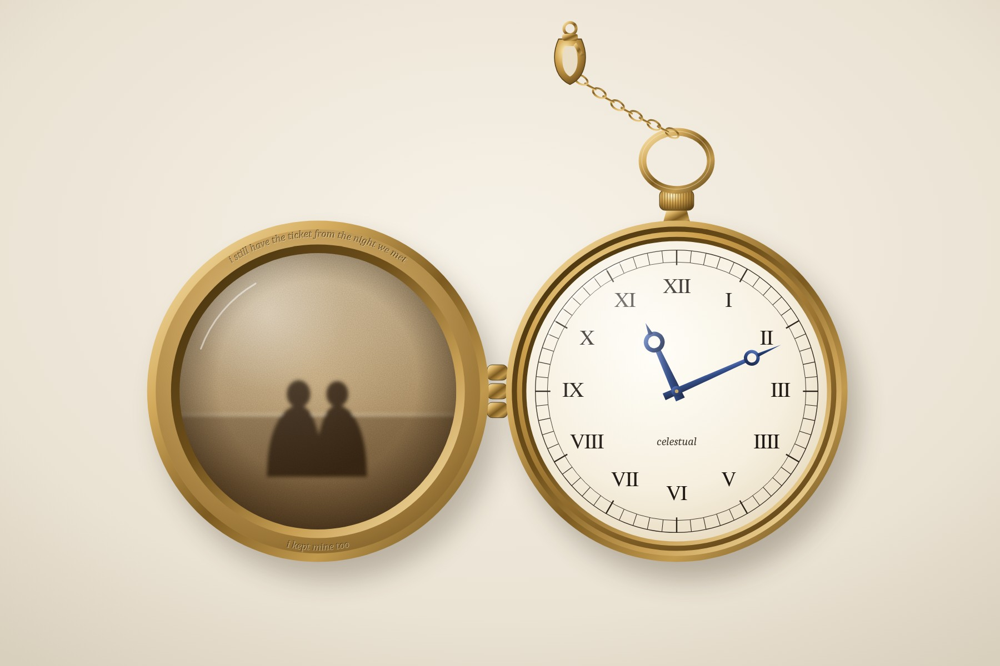
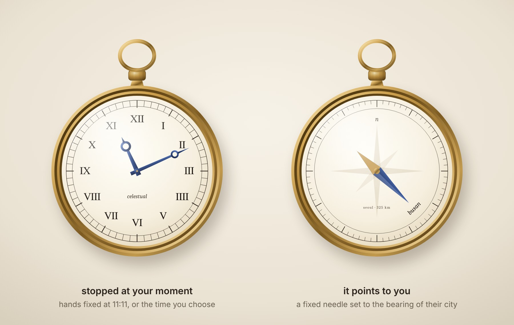
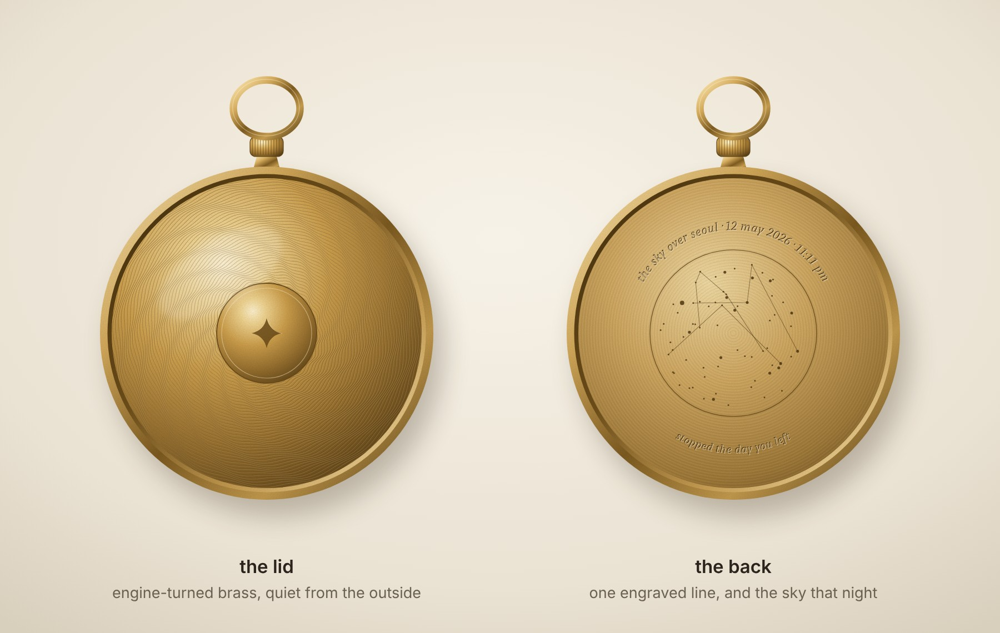
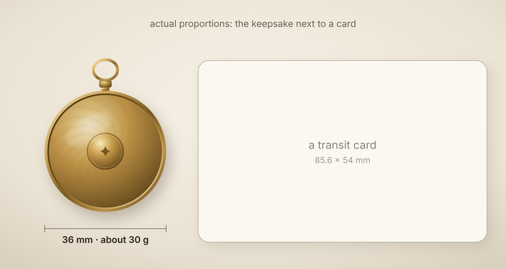
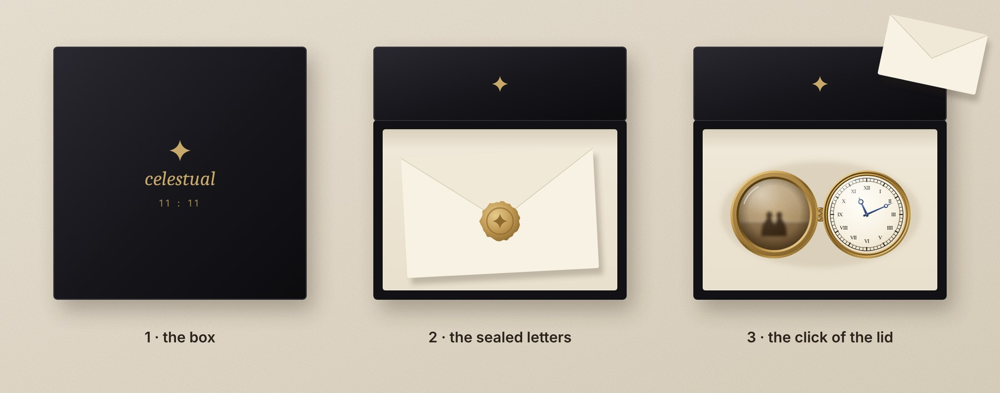
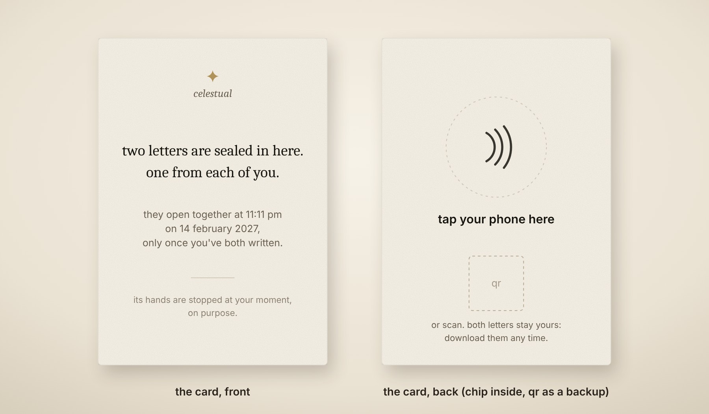
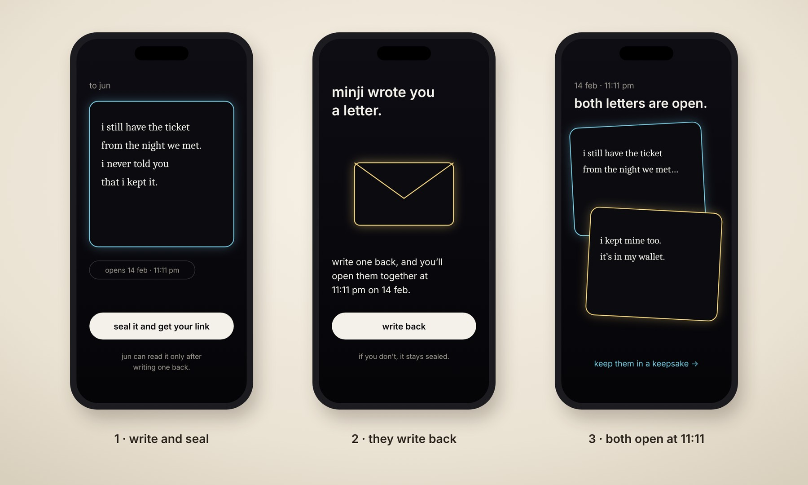

# Celestual: The Master Plan

Oct 15, 2026 · @Ace

> The keepsake and the 11:11 in one plan, step by step. Charts and diagrams are in the PDF version, [celestual-master-plan.pdf](./celestual-master-plan.pdf), and in the live doc. The images are concept renders made for this plan. The economics model is in [model/](./model/), and the research notes behind every tab are in [research/](./research/). This plan builds on [the turnaround memo](./celestual-turnaround-memo.md) and [the keepsake branch](./celestual-keepsake-branch.md).

**Contents**

1. [The plan, step by step](#the-plan-step-by-step)
2. [The object: what exists, and what we make](#the-object-what-exists-and-what-we-make)
3. [Making, selling and shipping](#making-selling-and-shipping)
4. [Economics](#economics)
5. [Marketing: the whole stack](#marketing-the-whole-stack)
6. [The 11:11](#the-1111)
7. [Legal and setup](#legal-and-setup)
8. [Evidence and sources](#evidence-and-sources)

## The plan, step by step

### The plan on one page

Celestual becomes one promise in three forms: **a letter that opens at 11:11, only when it's both of you.** Groups get it free as the 11:11 night. Couples get it free as a pair letter, and can keep it in a small brass keepsake, which is the part that earns money.

|  | The 11:11 | Pair letters | The keepsake |
| --- | --- | --- | --- |
| What it is | A club's one-night reveal: thanks, closer friends, i like you | One person writes a sealed letter, the other writes back, and both open at 11:11 on a date they choose | A small brass watch locket with its hands stopped at your moment, your photo inside, and both letters in the box |
| Who it is for | Close co-ed groups | Couples, starting with military couples in Korea | The same couples, when there is an occasion |
| Price | Free | Free | Planned at ₩79,000 for one, ₩139,000 for a pair; the tests set the final price |
| Its job | Proves the format and makes new pairs | Proves that the second person writes back | Pays for everything |
| Can it run now? | Only after the lawyer's written yes, at $0 | Only after the lawyer's written yes, at $0 | Not while you serve: after discharge |

**Three numbers decide the company, in this order:**

1. **A host commits** in writing to a night at Gate 0, four days after the lawyer's written yes: 25 October if the yes comes on 21 October.
2. **At least 40% of second people write back** in the pair-letter test.
3. **At least 15% of finished pairs tap "keep it in an object"** at a real price and leave a contact, if the lawyer allows sign-ups.

If the first fails, the pair test starts the next day. If under 25% write back, the letters aren't a shared ritual, so the locket would be one more photo locket: don't make it. If under 5% tap, keep the letters free and don't make the object. A result between a stop line and its bar gets one extension. If the pair test passes, the presale after discharge decides whether this is a business. The host only decides which test runs first, and the tap bar counts only if the lawyer allowed sign-ups.

**What does not change:** no money taken while you serve, by you or for you; no paid ads until something converts; and every gate written down in advance and held by someone outside the team.

**Your discharge date** sets every date from Phase 4 on. The plan assumes early April 2027; get yours in writing this week.

### How to use this document

**In a short gap, open This week.** This tab is the whole plan; the other tabs hold the detail behind each step.

- A **gate** is a pass-or-fail check on a fixed date. Its bar is written down in advance and held by the gatekeeper.
- A **branch** is what the lawyer's answer allows: 0 (nothing public), A (free tests only), or B (a shop run by someone else, not recommended).
- **Due** dates are deadlines. Dates from Phase 4 on assume discharge in early April 2027.
- The Object tab links to existing products instead of showing their photos, because the research tool could search the web but not open pages.

| Tab | Open it when | What it holds |
| --- | --- | --- |
| The object | Choosing what to make | What already exists, where the gap is, our design in concept images, the spec |
| Making, selling and shipping | Talking to suppliers, setting up the shop | Suppliers, minimums and lead times, the path from sample to first batch, the store and order system, shipping and returns |
| Economics | Setting prices and deciding how much to risk | What each order earns, the launch budget, break-even, scenarios, cash by month, what moves profit most |
| Marketing | Planning content and the presale | Audiences, the funnel, the content engine, channels and budgets, the calendar, the tool stack, weekly metrics |
| The 11:11 | A host says yes | How a night works, its gates, and the engine it shares with pair letters |
| Legal and setup | Before the lawyer meeting, and after discharge | Military-service rules, registrations, product safety, refunds, privacy, trademarks |
| Evidence and sources | Checking any number | How each claim was tested, how sure it is, and where it came from |

**What "tested" means here, honestly.** Nothing in this plan has been tested on real buyers yet; no supplier has quoted and no lawyer has answered. The pair test, the quotes and the presale are what test it. What has been done:

- **Celestual's own data** from the production database: counted and checked.
- **Market, cost and channel research** from web search results. The pages themselves could not be opened by the research tool, so every figure is marked with its source and a confidence level.
- **Models** of unit economics and cash, in code in docs/strategy/model that can be rerun with real quotes. The funnel in the Marketing tab is arithmetic on its assumed rates.
- **AI panels and critics** who reviewed the ideas from assigned perspectives. They are not people, and their numbers are judgments to be tested.
- **Concept images** drawn for this plan, not photographs of a made sample.

### The map

> *Chart, in the PDF and the live doc: how the parts fit · two free products, one paid, one engine*

Read it left to right: groups make pairs, pairs keep their letters in an object, and every object becomes a video that starts new pairs. Everything runs on the same rule, which is the brand: nothing opens until both have written.

### This week

Three things today, then eight by 25 October. Only the lawyer and the accountant cost money: ask each for a fixed fee in writing first, and pay from your own savings.

**Today**

- [ ] **Email a US accountant about the LLC.** A US company with one owner who is not a US tax person must file Form 5472 for each year money moved between it and its owner, even with no profit. If the 2025 form was extended, today is the last day. Ask which years are missing and what a late filing costs; the penalty is $25,000 per missing form. Due Oct 15, 2026
- [ ] **Switch off the paid checkout and the invented hearts:** turn off the Stripe checkout, refund the one $2.99 purchase, and set the 129 invented hearts to zero. Due Oct 15, 2026
- [ ] **Save the logs, then lock the open table:** export the database logs that show any read of the handle-lookup table, then lock and drop it. Give the logs to the lawyer, who decides whether anyone must be told; Korea's privacy law allows about 72 hours once you know. Due Oct 15, 2026

**By 25 October**

- [ ] **Get your service category and discharge date in writing** from your unit's admin office, to attach to the lawyer's questions. Due Oct 16, 2026
- [ ] **Book a private lawyer** (not through your unit) by email or the firm's online form, or ask family to book for you. Send the questions in the Legal and setup tab with the 11:11 questions in the turnaround memo. Answer due Oct 21, 2026
- [ ] **Name the outside gatekeeper:** someone off the team, not your partner, who will tell you no. Give them the branch table, the switching rule and every pass bar in this tab, in writing. They hold each gate and message you the result. Due Oct 16, 2026
- [ ] **List the hosts you know by name:** club officers in US Korean student associations and co-ed clubs, with each group's active roster. Personal conversations only until the lawyer answers, and no written commitments. Due Oct 16, 2026
- [ ] **Check the name for free:** search "Celestual", "셀레스추얼" and look-alikes such as "Celestial" in KIPRIS (Korea) and the USPTO, for jewellery (class 14), apps (class 9) and online services (classes 35 and 42). If something close exists in class 14, rename before anything goes public. Due Oct 19, 2026
- [ ] **Search Coupang, Naver Shopping and Kakao gifts by hand** for 포토 회중시계, 사진 회중시계, 커플 로켓 목걸이 and 곰신 선물. Screenshot anything close, with its price and review count. Due Oct 19, 2026
- [ ] **Name your non-serving helper:** a friend who will post, film and be awake at 11:11 pm on opening nights. They post nothing until the lawyer answers. Due Oct 21, 2026
- [ ] **Write the pair-letter spec and its copy**, without code, so it can be built in five days. Due Oct 25, 2026

### Step by step

> *Chart, in the PDF and the live doc: roadmap · six phases and their gates, October 2026 to February 2028 · dates from Phase 4 on assume discharge in early April 2027*

The highlighted gate on 31 January decides the keepsake. Each phase below is a checklist; a task waiting on the lawyer says so.

### Phase 0 · now to 25 October: the legal answer and Gate 0

The goal is to know what you are allowed to do, and whether a host exists, before anyone writes code. This week's actions are the start of this phase.

- [ ] **Get the lawyer's answer in writing and pick the branch** from the table below. With no written answer by the due date, you are in Branch 0 until it arrives; chase the firm every two days. Due Oct 21, 2026
- [ ] **Fix what isn't true before anything goes public:** add a notice on the site, not a social post, that the team added hearts nobody pressed and that they are gone; hide, don't delete, the 45 letters from the four most active accounts; email the writers of the 21 letters that showed invented hearts; and make every privacy line exactly true, including that letters and emails pass through US services. Done means a stranger could read the site and every post and find nothing invented. Due Oct 18, 2026
- [ ] **Draft six posts for the first test** and hold them until the branch is known. Due Oct 24, 2026
- [ ] **Give every post its own tracking link** and turn on web analytics, so the Monday sheet shows which post brought each visitor. Due Oct 22, 2026
- [ ] **Hold Gate 0 at 21:00 KST,** four days after the lawyer's written yes. Has a host promised in writing a group of 60 or more active members, two named contacts, five minutes at the group's own meeting on 9 or 10 November when everyone joins together (the "room moment"), and the reveal on 11 November? And are 3 hosts dated by 20 November? Due Oct 25, 2026

| The lawyer says | Branch | What it allows |
| --- | --- | --- |
| Nothing in writing yet | 0 until it arrives | Private preparation only; talks with hosts stay personal |
| Barred, or permission is needed and you don't have it | 0: dormant | Private preparation only; nothing public until discharge |
| Free activity is allowed in writing; revenue is not | A: $0, the one to plan on | The 11:11 and the pair letters, free. The price question only if sign-ups are allowed too. No samples, no sales |
| Yes to a shop owned and run entirely by someone who isn't serving | B: not recommended | It saves about two months and puts you both at risk: military discipline looks at who really does the work, and the brand, the design and the list would all be yours |

**Gate 0 decides Phase 1.** A host for 11 November means the pilot runs first (1A). A written host for 20 November only means that night runs and reports results but decides nothing, and the pair letters start the week after. No host means the pair letters start the next day (1B). Branch 0 means nothing goes public until the answer comes, or until discharge.

### Phase 1 · 26 October to 20 November: the first test

One test at a time, chosen by Gate 0. Both versions cost $0, and both start only after the lawyer's written yes.

**1B, no host (the likelier case): pair letters for Pepero Day**

- [ ] **Build the pair letter in 10 to 15 hours.** You direct it from your phone in the evenings and Claude writes the code, as the turnaround memo planned for the 11:11. One person writes and seals a letter and sends their own link; the partner writes back; both open together at 11:11 on the chosen date: 11:11 pm by default, or 11:11 am on a weekend or holiday when either person serves. 19+ in Korea and 18+ elsewhere, asked as a birth year; one reminder at most; a one-tap block; unanswered letters deleted after 30 days. Done means a friend outside the team can write, seal, send, write back and see both letters open on a test date. Due Nov 1, 2026
- [ ] **Only if the lawyer allowed sign-ups, end it with the priced object question:** "keep it in an object" at ₩119,000 or ₩139,000 for the pair, shown at random, leading to a sign-up, never a checkout. If sign-ups aren't allowed, this test measures write-backs only. Due Nov 1, 2026
- [ ] **Open it with "11.11 at 11:11":** write your person a letter that opens with theirs on Pepero Day, which is a couples' day too. Say "11.11" in posts, never the trademarked "빼빼로". Soldiers have their phones only from 18:00 to 21:00 on weekdays, so offer military couples 11:11 am on Christmas or New Year's Day instead. Due Nov 2, 2026
- [ ] **Your helper posts three times a week:** each a real reveal or a letter excerpt shared with both people's consent, each with its own tracking link. Reminders go by email and carry no offer; Kakao alerts wait for a registered business.
- [ ] **Pairs come from public posts.** Don't recruit through your unit or fellow soldiers. Count only pairs that arrive through a tracked public link, and report friends' pairs separately.
- [ ] **Your helper watches the first opening night at 11:11 pm** for errors, and collects reactions only with both people's written consent. You read the results the next evening. Due Nov 11, 2026
- [ ] **First read:** pairs started, write-backs within 7 days, and taps on the priced object question if it is on. Due Nov 20, 2026
- [ ] **If the lawyer said you may file in your own name, file the trademark now** (classes 14 and 35, about ₩546,000): examination takes 12 to 20 months, and the name goes public this month. Due Nov 20, 2026

**1A, a host committed: the pilot night first,** with the steps from the turnaround memo:

- [ ] **Live check:** joining and picking work in production, and 3 hosts are committed. Otherwise the pilot moves to 20 November. Due Nov 1, 2026
- [ ] **The host posts a save-the-date only.** Due Nov 4, 2026
- [ ] **The gatekeeper freezes the gate sheet.** Due Nov 5, 2026
- [ ] **Rehearse with 20 to 30 testers:** 80% join within 5 minutes and the reveal is on time; the go or no-go is on 8 November. Due Nov 6, 2026
- [ ] **The room moment on 9 or 10 November, then the reveal at 11:11 pm local,** with a named non-serving responder awake for it. No responder, no night. Due Nov 11, 2026
- [ ] **Delete one-way picks 72 hours after the reveal.** Due Nov 14, 2026

Start the pair letters the week after, aimed at the holidays. The full night rules are in the turnaround memo.

**Every Monday, in both cases:** log posts, views, link taps, letters started, write-backs and object taps in one sheet the gatekeeper can see.

### Phase 2 · 21 November to 31 January: the holidays, and the keepsake verdict

The goal is a clean answer by 31 January: do second people write back, and do they want the letters in an object?

- [ ] **Keep posting three times a week,** and push "open together at 11:11 am on Christmas". It is a Friday holiday, so soldiers have their phones. Due Dec 25, 2026
- [ ] **Keep the priced object question on,** if the lawyer allowed it.
- [ ] **Ask 20 military couples,** through the 곰신 cafe manager, whether they would keep their letters in an object and which face they prefer, only if the lawyer allowed product research (question 1.5). Ask what they would pay only if the lawyer allowed sign-ups.
- [ ] **Only if the lawyer allowed posts about the object, show the two faces and the two finishes as concept renders,** each labelled "concept, not made yet". "Where can I buy" comments pick the face and the finish. Due Jan 15, 2027
- [ ] **The 11:11 track,** if a host ran a pilot: second nights with the pilot groups in December, and Gate 1 ten days after the third night.
- [ ] **Write the Korea memo for the 11:11:** consent, age checks, White Day nights. Due Jan 31, 2027
- [ ] **Hold the pair-test verdict.** Pass: 200 or more pairs from outside the team, 40% or more writing back within 7 days, and 15% or more tapping the object if it was on. Stop: under 25% writing back, under 5% tapping, or under 100 outside pairs. In between: one extension to 28 February, decided on 1 March. Due Jan 31, 2027

### Phase 3 · February to March: Valentine's, White Day, and what leads in 2027

The goal is to arrive at discharge with the presale ready to start, without having broken any rule while serving.

- [ ] **Valentine's Day is a Sunday:** military couples' letters open at 11:11 am, so soldiers can join; the rest open at 11:11 pm. Due Feb 14, 2027
- [ ] **White Day is a Sunday too,** and it is the day men give, usually something pricier. Due Mar 14, 2027
- [ ] **Decide what leads in 2027** on 1 March, the day the 11:11 holds its romance gate (Gate 2). If both passed, the line is "it opens at 11:11, only when it's both of you": pairs and the object come first, and the 11:11 runs as seasons. If only the pair test passed, lead with pairs and the object. If only the 11:11 passed, lead with group nights and don't make the object. If neither passed, pause until discharge. Due Mar 1, 2027
- [ ] **If the keepsake passed and the lawyer allowed sign-ups, ask pair-letter users for consent** to hear about the presale by email. That list is the presale.
- [ ] **Prepare privately, as far as the lawyer allowed:** the spec, the presale page draft, the ten updates. Nothing goes to a supplier or goes public until discharge.
- [ ] **Decide where you will live and work after discharge,** and who could learn to finish a locket as a second pair of hands. Due Mar 31, 2027

### Phase 4 · April to July 2027: discharge, samples and the presale

Every date here assumes discharge in early April 2027 and counts from that week. If yours is later, move every step with it, and start nothing before it, including on final leave. The detail is in the Making, Economics and Marketing tabs.

- [ ] **Week 1: register the business,** a sole proprietorship under simplified VAT, in about two working days. File the online-sales report unless you are exempt, open the SmartStore account, and order the reference samples. Due Apr 9, 2027
- [ ] **Open the Wadiz waitlist** with the concept renders, labelled as concepts. Invite the people who agreed to hear about the presale to join it themselves; never upload the list. Aim for 400 or more sign-ups before the presale opens. Due Apr 20, 2027
- [ ] **File the trademark and the locket's design** if they aren't filed yet: the trademark in classes 14 and 35, the design before the presale page goes public, claiming Korea's 12-month grace period for renders already shown on the waitlist page or in posts. Due Apr 30, 2027
- [ ] **Samples, weeks 1 to 8:** reference samples in week 1, custom samples from two factories ordered by week 4, quotes in Seoul, and a lab test of the chosen finish. Due May 28, 2027
- [ ] **Approve the golden sample only if it passes:** lead under 0.05% and cadmium under 0.01% in every metal part, nickel-free plating, 500 open-and-close cycles, three 1 m drops, heat and cold, and a 3 to 5 kg pull on the clasp. The golden sample is the one finished piece every later piece must match. Then order 12 more like it: 10 for creators and a pair to film. Due May 28, 2027
- [ ] **Hold the first in-person 11:11 night** with a group you can reach after discharge, whatever the remote result. Due May 31, 2027
- [ ] **Build the order step into the pair letter:** photo upload with a crop guide for two faces, the time to set, one line from each person written by hand on the phone, and both people's consent. Done means one test order arrives as one complete row in the order sheet. Due Jun 4, 2027
- [ ] **Run the presale for four weeks,** from Jun 14, 2027 to Jul 11, 2027, with ten or more updates. If the waitlist is under 250 two weeks before, move it back once, by up to four weeks, with every later date. If it is still under 250, open with the goal at 40 orders and let the presale gate decide. Set the Wadiz goal at the stop line, about ₩4.5M or 40 orders, once Wadiz confirms that backers are charged only if the goal is met. No early-bird discount deeper than 10%. Before the page goes live, ask Wadiz when it pays out. If it pays about two weeks after the close, the page promises delivery by 8 October 2027; if later, move that date by the same amount.
- [ ] **Hold the presale gate.** 100 orders or more, about ₩11M at full price, roughly pays back the launch, so continue. Count each order at the 10% early-bird price as three quarters of an order, because the discount comes straight out of the margin. 40 to 99: make and ship them, change the price, face or content, and let the shop gate in February decide. Under 40: the goal is missed, nobody is charged, the object stops and the letters stay. Due Jul 18, 2027
- [ ] **Order the batch when Wadiz pays out,** for the presale plus two months of shop stock: about 285 lockets in the middle case. Due Jul 30, 2027
- [ ] **Send every backer their own order link** the day the presale closes, and chase until each order has its photo, time and both handwritten lines, before the batch arrives. Due Aug 31, 2027

### Phase 5 · August 2027 to February 2028: the first pieces, 11.11 and the shop gate

The goal is a shop that sells 40 or more orders a month without paid ads, or an honest decision to run it as a side project.

- [ ] **Finish the presale orders in Seoul and ship them,** then ask every buyer for a photo review and, with both people's consent, their opening. Keep each photo until the 3-month defect window closes, then delete it. Due Sep 30, 2027
- [ ] **Open the SmartStore shop** with the batch's shop stock, list it for Naver blog reviews through 리뷰노트, and sign two or three moment partners near training centres on a 15 to 20% code. Due Oct 1, 2027
- [ ] **Reorder every month, two months ahead,** while the shop sells; a reorder takes 6 to 8 weeks. The first covers December and January. Due Oct 4, 2027
- [ ] **Prepare 11.11 with the object on sale:** the first Pepero Day the keepsake can actually be sold. Due Nov 11, 2027
- [ ] **Add the entry item** if the pair-letter users' poll favoured it: a ₩29,000 to ₩39,000 brass 11:11 charm for 100 days, friends and bags.
- [ ] **Hold the 11:11's December gate:** did 40 or more groups run a night, half without founder help? Due Dec 13, 2027
- [ ] **Hold the shop gate:** does the keepsake sell 40 or more orders a month without ads, averaged over October to February? Below both bars, Celestual is a side project, said out loud. Due Feb 29, 2028
- [ ] **Later, only if the shop passed:** apply to Kakao gifts after six months of reviews. Test the US through Etsy with 10 to 20 orders once there are 50 or more Korean reviews, a customs ruling on the tariff code and origin, and a US version of the model. Every US parcel now pays duty, and Etsy's fees plus prepaid shipping can take a single's whole margin, so decide with an accountant which business sells to the US.

## The object: what exists, and what we make

### Verdict

Make one jewellery-scale locket for couples, and sell it as a locket, never as a "photo watch". Nothing like it surfaced in Korea, the US or the UK. The nearest products are $9 to $30 photo pocket watches for dads and groomsmen, and at the top a $149 mechanical watch with a photo holder.

So the design has to look different even in a thumbnail:

- **Smaller:** 36 mm, where photo watches run about 46 mm.
- **Hidden:** a colour photo inside, not a black-and-white etching on the lid.
- **Stopped:** hands fixed at your moment.
- **Written:** one line of each person's letter, in their own handwriting, inside the lid.

Price it in the band where Korean couples already spend. Mid-range couple rings cost ₩100,000 to ₩300,000 each, and people in their 20s call ₩100,000 to ₩130,000 a fitting anniversary gift, and spend about ₩271,600 on each anniversary (2023 survey). Lead with the pair at ₩139,000, next to the $85 to $140 pair price of long-distance bracelets such as Totwoo and Bond Touch.

Confidence that no direct competitor exists is medium-low. The search index covers Coupang, Naver Shopping and Kakao gifts poorly, so search those three by hand; it is on this week's list.

### What already exists

Twenty products that set the look, the price and the expectations. There are no product photos here: the research tool could search the web but could not open pages, so it could not copy pictures. Tap a name to see the photos on the shop's own page; some names open a search page, so scroll for the item named. With five minutes, open these first: the Amazon photo watch (what to avoid), the Charles Hubert watch (the quality bar), the Abbott Lyon locket (the price and the secret engraving), the Idus mini locket (the Korean price) and Truest North (a needle that points to a place). Prices come from search results, not opened pages, and may have changed.

| Product | What it is | Price | Take or avoid |
| --- | --- | --- | --- |
| **Photo watch** · [Amazon photo pocket watches](https://www.amazon.com/ZFN-Personalized-Engraved-Vintage-Groomsmen/dp/B0GYCQB5V2) | About 46 mm, quartz, a black-and-white photo etched on the lid, sold for dads and groomsmen; dozens of near-identical listings | About $27 | Avoid looking like this |
| **Photo watch** · [Charles Hubert photo pocket watch](https://www.etsy.com/market/custom_pocket_watches_with_photo) | Mechanical hunter case with a photo holder and an engraved cover; the top of the photo-watch range | About $149 | The bar for hinge, glass and finish |
| **Photo watch** · [SHOWROOM photo pocket watch](https://showroom.co.kr/category/%ED%9A%8C%EC%A4%91%EC%8B%9C%EA%B3%84/52/) | 47 mm corporate-gift photo watch on a stand; Korea's nearest item | ₩59,000 | The ceiling for anything called a "watch" in Korea |
| **Photo watch** · [Idus pocket-watch pendants](https://idus.com/search?keyword_channel=relate&word=%ED%9A%8C%EC%A4%91%EC%8B%9C%EA%B3%84) | Vintage pocket-watch pendant | ₩28,000 | The local look-alike |
| **Locket** · [Abbott Lyon Photo Love Locket](https://abbottlyon.com/products/photo-love-locket-necklace-gold) | Gold-plated steel locket with a photo and a secret engraving inside | From £89, about $118 | The fashion-locket model; its secret engraving is our handwriting ring |
| **Locket** · [Monica Rich Kosann lockets](https://www.monicarichkosann.com/collections/lockets-under-500) | Heirloom sterling lockets with two photos; the designer tier | $245 to $475 | Lockets can be heirlooms |
| **Locket** · [Lisa Angel photo locket](https://www.notonthehighstreet.com/lisaangeljewellery/product/personalised-photograph-oval-star-locket-necklace) | Plated locket; the buyer emails a photo; 1.4M+ orders on its storefront | £8 photo add-on | Collect and crop photos online for the buyer |
| **Locket** · [silkpursesowsear brass locket](https://www.notonthehighstreet.com/silkpursesowsear/product/simple-personalised-photo-locket) | Solid brass with the photo on the metal |  | The material reference: warm, vintage, handmade |
| **Locket** · [Idus mini photo locket](https://www.idus.com/v2/product/ace535fc-6fdf-4991-bf37-60048081a42c) | Mini locket with photo and engraving, made in 4 to 6 days; sellers warn the snap is fragile | About ₩25,000 | A sturdy hinge is a selling point |
| **Compass** · ["I'd be lost without you" necklaces](https://www.walmart.com/ip/15843604656) | Small compass pendant sold on a message card; a Walmart best-seller tag | $13 to $80 | Romantic compasses still point north |
| **Compass** · [Truest North](https://truestnorthcompass.com/products/truest-north-compass) | GPS compass whose needle points to a place you choose; Kickstarter and press | From $180 | Proof that "points to a place" sells; ours needs no battery |
| **Compass** · [Korean silver compass necklaces](https://www.idus.com/v2/search?keyword=%EB%82%98%EC%B9%A8%ED%8C%90) | 925 silver vintage compass pendants | ₩59,000 to ₩120,000 | The local compass price |
| **The moment** · [The Night Sky](https://www.thenightsky.com/shop/night-sky-classic-star-map-print) | The sky over a chosen place on a chosen date; 10.1K Trustpilot reviews | $39 print | A frozen moment sells; show a live preview before payment |
| **The moment** · [Under Lucky Stars](https://support.underluckystars.com/hc/en-us/articles/360022352254-How-to-order-what-are-the-prices) | Premium star maps | $130 to $250 | A premium holds when the object is computed from the couple's own data |
| **The moment** · [Korean constellation frames](https://www.wframe.co.kr/goods/goods_view.php?goodsNo=1000000175) | Zodiac templates, not a real date and place | ₩14,000 to ₩59,500 | No date-accurate sky in Korea yet |
| **Long distance** · [Lovebox](https://blog.lon.tv/2024/03/04/the-lovebox-review/) | A box whose heart spins when a message arrives; 85,000+ of the classic sold, about €6M revenue in 2020 | $130 to $175, plus $4.99 a month | Couples pay for an object plus a ritual |
| **Long distance** · [Totwoo touch bracelets](https://www.walmart.com/ip/TOTWOO-Candy-Collection-Long-Distance-Touch-Bracelets-Couples-Vibration-Light-Love-Pair-Couples-Long-Relationship-Gifts-Girlfriend/15331774355) | Bracelets that light and buzz when the other is touched | $85 to $140 a pair | The pair-price anchor; needs charging |
| **Korean couples** · [Couple rings](https://sonmastem.com/couple-ring-top5/) | Entry and mid-range brands such as 로이드; the main couple-jewellery budget | ₩20,000 to ₩300,000 a ring | The budget we compete with |
| **Military couples** · [곰신 letter paper](https://www.idus.com/v2/product/361f9daf-3406-4014-b60d-10fd6162a0cb) | Letter paper with both names, by service branch; many reviews, and a military-couple app sells its own | ₩5,500 | Military couples already buy things for their letters, but cheap ones |
| **Charms** · [Photo keyrings](https://www.photomon.com/product/goods-acrylic-keyring/acrylic-goods-bundle) | Acrylic photo charms, some with NFC | ₩3,000 to ₩16,000 | Charms are cheap; ours must read as jewellery |

### Where the gap is

> *Chart, in the PDF and the live doc: search results, Oct 2026 · listing price ranges, not averages · ₩1,480 to the dollar, £1 ≈ $1.33 · designer lockets run off the scale to ₩703k*

The gap is not a price; it is a product. Nobody sells a jewellery-scale locket that is computed from a couple's own moment, the way star maps are, and nobody joins a keepsake to a letter that opens only when both have written. Photo watches are cheap because they are generic, and the pair can charge couple-ring prices only if it never looks generic.

### Our design: one small body, two faces, a sealed card

These are concept renders drawn for this plan, not photographs of a made sample. The samples decide the final piece.

*Concept render, not a photo of a made sample.*

**Open,** the lid holds your own photo under domed glass, ringed by one line from each of your letters, engraved in each person's own handwriting. The face holds the moment, its hands stopped at 11:11 or at the time you choose. That ring of handwriting is what makes the letter part of the object, and it is what a copycat can't make.

*Concept render, not a photo of a made sample.*

**Two faces on one body.** The watch face suits most couples. The needle face is for distance: it is set to the bearing from your city to theirs.

*Concept render, not a photo of a made sample.*

**Outside,** the lid is engine-turned brass. The back carries one engraved line and the sky over your city that night; the stars drawn here are illustrative.

*Concept render, not a photo of a made sample.*

**Size:** 36 mm across and about 30 g, small enough for a bag charm or a necklace.

*Concept render, not a photo of a made sample.*

**The box opens in three beats:** the box, the sealed letters, the click of the lid. That is also the shot list for every unboxing video.

*Concept render, not a photo of a made sample.*

**The card** explains why the hands don't move, and holds the chip that opens both letters online, with the QR as a backup.

| Part | Spec | Why |
| --- | --- | --- |
| Case | Brass hunter case, 34 to 38 mm, about 30 g, hinged at 9 o'clock | Light enough for a bag; quiet outside, antique inside |
| Finish | Hand-patinated brass under a clear e-coat (the base cost), or a silver-tone, nickel-free plating of 1 to 2 microns for about ₩2,000 to ₩4,000 more; lead under 0.05% and cadmium under 0.01% in every metal part, tested for nickel release | The content test picks between the two finishes |
| Dial | Cream, Roman numerals, blued hands glued at the chosen time; no movement | No battery to die, $2 to $5 cheaper, about 3 mm thinner |
| Photo | The couple's own, trimmed like a photo-booth frame, under domed mineral glass; the window is about 26 to 30 mm, so the crop guide must fit two faces | No printing, no photo moderation, and it can be swapped after a breakup |
| Inside the lid | One line from each person's letter, laser-engraved in their own handwriting, around the photo. No quote yet; if it isn't legible on a sample, the two lines go on a printed card behind the photo | Joins the free letter to the paid object; a copy can't engrave your partner's sealed words |
| Back | One engraved line; the back has room for 3 to 4 lines of about 20 Latin letters, or 2 lines of 10 to 12 Hangul. The sky is an option | The personal part, done in Seoul |
| Chain | Short chain with a trigger clasp | Switches between bag charm and necklace |
| Box | Matte black drawer box, cream insert, wax-sealed envelope | Three beats on camera, no glare |
| Card | Paper card with an NFC chip and a QR backup | A metal case blocks the chip, so it lives in the card |

### Decisions still open, and what settles each

One is already made: it is sold as a locket, not a watch. The rest are decided by a test, not by taste.

| Decision | Options | Settled by | When |
| --- | --- | --- | --- |
| Price of the pair | ₩119,000 or ₩139,000 | The pair test shows each price at random, if the lawyer allowed sign-ups; compare taps. Otherwise the Wadiz waitlist decides after discharge | 31 Jan |
| The face | Watch stopped at your moment, or the needle that points to you | Which one earns more "where can I buy" comments and DMs per 1,000 views | Dec to Jan |
| The finish | Silver-tone, or hand-patinated brass | The same content test, one post each | Dec to Jan |
| Size | 34, 36 or 38 mm; 36 mm is the working size | Samples in hand: does the 26 to 30 mm photo window fit two faces? | First samples |
| Handwriting inside | Laser-engraved handwriting, or a printed line | Legibility on a sample at that size, and its cost | First samples |
| An entry item | A ₩29,000 to ₩39,000 brass 11:11 charm for Pepero Day, 100 days and friends | A one-question poll of pair-letter users if the lawyer allowed sign-ups; otherwise the waitlist after discharge | Dec to Jan |
| The opening time for military couples | 11:11 am on a weekend or holiday | Already decided by phone rules: soldiers can use phones only 18:00 to 21:00 on weekdays and 08:30 to 21:00 on weekends and holidays | Now |

In Branch A there are no samples before discharge. The face and finish posts use the concept renders, each labelled "concept, not made yet", and run only if the lawyer allowed posts about the object. Otherwise these choices wait for the first samples after discharge.

## Making, selling and shipping

### Verdict

Seoul has no pocket-watch case makers, so the first 100 to 300 pieces should use a semi-custom brass case blank from a Chinese factory. Everything personal is done in Seoul: the dial set to the couple's time, the photo, both engravings, the checks and the packing. The label will most likely still say "Made in China", because finishing in Seoul does not usually change where a product is from. Say "finished by hand in Seoul", never "made in Korea", unless customs confirms it.

By estimate, not quote, that costs about ₩34,400 for a single and ₩62,800 for a pair. No supplier has quoted yet, and your own hours on each order are not counted. From the purchase order to 100 sellable pieces takes about eight weeks.

Two rules before any order. **Numbers in the order, not "lead-free":** lead under 0.05% by weight in every metal part, cadmium under 0.01%, and nickel-free plating, backed by mill certificates and a lab test. Free-machining and many casting brasses hold 1.8 to 3.7% lead, and brass sold as lead-free can still be over a jewellery limit. **Nothing is ordered before discharge.**

| Route | Cost per case | Time | Minimum | Verdict |
| --- | --- | --- | --- | --- |
| A. Semi-custom brass case from a Chinese factory, finished in Seoul | About $4 to $8 | About 8 weeks from order to 100 pieces | 100 to 300 | **The default** |
| B. Lost-wax casting in Jongno from your own 3D model | About ₩10,000 to ₩25,000, 2 to 4 times route A | 12 to 16 weeks | No formal minimum | Later, for a shape only you own |
| C. Stock watch pendants from Alibaba | About $1.50 to $2.50 | 2 to 4 weeks | 10 to 100 | Reference samples only; it looks like the commodity |

Case prices are listing prices and estimates from search results, not quotes. The first real quotes replace them.

### Who makes what

Get at least three quotes for each part. Prices exclude VAT; most are listing prices or estimates.

| Part | Where | Minimum | Price at 100 | Lead time |
| --- | --- | --- | --- | --- |
| Brass hunter case blank, semi-custom | Factories in Guangzhou or Yiwu through Alibaba or 1688, via a Korean buying agent | 100 to 300 | $4 to $8 | 3 to 5 weeks, plus a week of freight |
| Reference samples: stock watch pendants and lockets | Alibaba, AliExpress, 1688 | 10 to 100 | $1.50 to $2.50 | 2 to 4 weeks |
| Cream Roman dial | A Chinese dial printer, or printed in Seoul | 10 to 50 | $0.30 to $1.00 | 1 to 3 weeks |
| Fixed hands | Chinese watch-parts suppliers; parts dealers in Jongno 4-ga | About 100 pairs | $0.05 to $0.30 a pair | 1 to 2 weeks |
| Domed glass, two per piece | China, or craft suppliers in Dongdaemun | 10 to 100 | ₩100 to ₩500 each | Days to 2 weeks |
| Chain, trigger clasp and rings | The accessory-parts floor of Dongdaemun Jonghap Market | By the pack | ₩1,000 to ₩3,500 a set | Days |
| Clear coat, or a thin gold flash | Plating shops in Jongno, or the factory | A lot minimum by weight | Coat ₩300 to ₩1,500; gold flash ₩2,000 to ₩4,000 more | 3 to 7 days |
| Engraving, back and inside the lid | Laser shops in Seoul, or your own fibre laser later (₩2.7M to ₩4.0M) | 1 | ₩2,000 to ₩5,000 a piece for a short line (estimate) | Same day to 3 days |
| NFC chip (NTAG213) | nowwin, KOREA NFC | 1 | ₩250 to ₩610 | 1 to 7 days |
| Letter card and envelope | Korean online printers | About 100 | ₩300 to ₩1,000 a set | 3 to 7 days |
| Wax seal sticker | Sodastamp | 1 | ₩350 to ₩460 | About a week |
| Drawer box, custom | Packative, Betterbox, Box114 in Seoul; Bangsan market only from about 1,000 | 50 to 100 | ₩8,000 to ₩20,000 | 2 to 4 weeks |
| Lab tests: lead, cadmium, nickel | KTR, KCL, KATRI, FITI or KOTITI | Per sample | ₩200,000 to ₩1M for the first set (₩500,000 in the launch budget) | 1 to 3 weeks |

Imported parts pay 8% Korean duty and 10% VAT on their landed value, and goods for resale need a formal import declaration whatever their value.

### From sample to the first batch

> *Chart, in the PDF and the live doc: production path · route A, weeks counted from discharge in early April 2027*

In the default plan this starts in the week of discharge, early April 2027. The golden sample is approved in week 8, the presale runs from 14 June to 11 July, and the batch is ordered once Wadiz pays out, about two weeks later. With about eight weeks from order to finished pieces, the first pieces reach buyers in late September, and the presale page promises 8 October, two weeks to spare. Allow one extra sample loop of 2 to 3 weeks, and move every later date with it. The plan takes no faster route: ordering before discharge would mean a shop run for you while you serve.

### The operations stack

> *Chart, in the PDF and the live doc: operations loop · from the first post to the next post*

The pair letter does the work competitors do by hand: it collects the photo, crops it to the window, records the time to set and the line each person wrote, and takes both people's consent. Each order then arrives at the workbench as one complete row, with nothing to chase by message. Supabase and Resend are already part of Celestual, so the only new systems are Wadiz, SmartStore and the order sheet. The order step itself is built in Phase 4, two weeks before the presale.

### Shipping, returns and service

A boxed locket weighs about 150 to 300 g. Start with Korea Post or convenience-store parcels, and move to a fulfilment company only when packing takes more than a day a week.

| Option | Price | When to use it |
| --- | --- | --- |
| GS25 or CU half-price parcel, store to store | ₩1,800 to ₩1,900 up to 500 g | Cheapest; the buyer collects from a convenience store |
| Korea Post counter | ₩4,000 | Home delivery at low volume |
| Courier contract for a small seller | About ₩2,500 to ₩3,500 | Home delivery once volume is steady |
| Fulfilment company, all-in (FASSTO and others) | ₩2,700 to ₩3,500 an order | Past about 30 orders a week |
| Returns | ₩3,000 each way; the seller pays for defects |  |

**Service rules:**

1. State the delivery date on every page and in every presale reward.
2. Answer within 24 hours; replace a defective piece first and ask questions later.
3. Take back defects for 3 months, and refund within 3 business days of the return arriving.
4. Delete the photo when the 3-month defect window closes, and say so before the upload.
5. Before payment, show the separate notice and the unticked consent box for personalised goods.

**The US, later.** Start on Etsy with 10 to 20 test orders, once there are 50 or more Korean reviews.

- **Shipping:** EMS costs about ₩23,000 to ₩26,000 for 0.5 kg, or from about ₩16,390 through a consolidator with duty prepaid.
- **Duty:** Korean-made goods have paid about 12.5% since 24 July 2026. A case made in China may still count as Chinese, which costs more.
- **Before the first US order,** get a free binding ruling from US Customs on the tariff code (imitation jewellery, 7117.19.90) and on origin.
- **A US fulfilment and engraving partner** makes sense only past 100 to 200 US orders a month.

## Economics

### Verdict

**A pair sold through the presale leaves about ₩40,500, and a single about ₩20,000,** after making, the platform fee, shipping, defects and ₩7,000 of content. An order bought with a paid ad costs ₩25,000 to ₩130,000 in Korea. At the plan's ₩45,000, a single loses about ₩18,000 and a pair barely breaks even, so the money comes from free channels or not at all.

**Starting costs about ₩4.0M,** almost all of it after discharge, and about 104 presale orders at full price pay it back. Each presale order counts at about ₩38,300 here, before content and with 55% of orders as pairs, because the launch budget already pays for the presale's photos, early pieces and tools. A 10% early-bird price moves break-even to about 140 orders.

**If 600 orders come in the first year, it earns about ₩17.3M:** 100 presale orders, then about 42 a month in the shop for 12 months, on about ₩68M of revenue. Nobody has measured these orders yet. They need a waitlist rate six times the past one and a shop that sells without ads, so until the presale measures them, plan your time and money on the low case. A company with ₩500M of revenue a year would need about 4,500 orders a year, so growth has to come from an entry item, Kakao gifts and the US, not from the locket alone.

**The money you need, and when:**

- **Before discharge:** only the lawyer's and the accountant's fees, and the trademark if the lawyer lets you file it early; it then comes out of the April budget. Ask each for a fixed fee in writing first.
- **April to June 2027:** about ₩3.3M of launch costs, plus about ₩0.5M kept for surprises.
- **The low point:** about ₩4.2M out of pocket in September 2027, because the first batch also makes two months of shop stock. Keep about ₩5M you can reach from April to December 2027.
- **If the presale fails:** the loss is the launch money spent, about ₩3.4M.

Every number here comes from the model in docs/strategy/model, which can be rerun with real quotes. Costs are the middle estimates of the sourcing research, and no supplier has quoted yet; prices are the planned ones.

### What one order earns

> *Chart, in the PDF and the live doc: economics model · middle-estimate costs from the sourcing research · Wadiz Basic plan, 10% plus VAT on the fee*

**What one piece costs to make,** by estimate rather than quote, at 100 to 300 units, before VAT, with dollars at ₩1,480:

| Part | Cost per locket (₩) |
| --- | --- |
| Brass case, semi-custom from a Chinese factory, about $5 | 7,400 |
| Clear e-coat over polished brass, no gold | 1,500 |
| Dial, fixed hands, two domed glasses | 1,600 |
| Photo print and fitting | 800 |
| Chain, trigger clasp and rings | 2,000 |
| Engraving: one line on the back | 3,000 |
| Engraving: the handwriting ring inside the lid (no quote yet) | 4,000 |
| Scrap and spares, 7% of the parts | 1,421 |
| Freight from China and 8% Korean duty | 1,000 |
| Quality checks, and a lab re-test for each later batch | 1,500 |
| **One locket** | **24,221** |
| Box, card with NFC chip, envelope, wax seal, pouch | 10,200 for a single, 14,400 for a pair |
| **A single, boxed** | **34,421** |
| **A pair, boxed** | **62,842** |

**What is left per order,** after ₩7,000 of content, with no VAT due (under ₩48M of sales a year):

| Order | Wadiz presale | SmartStore | Own site |
| --- | --- | --- | --- |
| Pair, ₩139,000 | ₩40,500 | ₩46,600 | ₩50,600 |
| Single, ₩79,000 | ₩20,000 | ₩23,400 | ₩25,700 |

Above ₩48M of sales a year, simplified VAT takes about 1.5% of the price, less a small credit: about ₩1,000 from a single and ₩1,700 from a pair. Above ₩104M, general VAT takes about ₩2,500 to ₩3,000 from a single and ₩4,300 to ₩5,300 from a pair.

The cheapest saving is a stock drawer box with a branded sleeve, about ₩5,500 less a unit. The upgrade that shows most is a thin gold flash, or a silver-tone, nickel-free plating, each about ₩2,000 to ₩4,000 more. A full micron of gold would add about ₩15,600 in metal alone.

### What it costs to start

About ₩4.0M, almost all of it after discharge. The first batch is not in this list: the presale pays for most of it (see Cash, month by month).

| Item | Cost (₩) | When |
| --- | --- | --- |
| Reference samples from China, by express | 450,000 | April 2027 |
| CAD model and 3D-printed fit checks | 200,000 | April; optional, if the stock case needs changes |
| Trademark, classes 14 and 35, filed yourself | 546,000 | April, unless filed earlier |
| Registration fees and local tax | 50,000 | April |
| Custom samples from two suppliers | 300,000 | May |
| Lab tests for lead, cadmium and nickel | 500,000 | May |
| Box proof and foil die | 150,000 | May |
| Design registration, filed yourself | 150,000 | May, before the presale page goes public |
| Twelve pieces made ahead of the batch, at sample prices: 10 for creators and a pair to film, shipped | 630,000 | June |
| Photography and props | 200,000 | June |
| Tools for six months | 270,000 | April to September |
| Contingency, 15% | 516,900 |  |
| **Total** | **3,962,900** | About $2,700 |

### Break-even and three scenarios

The launch pays for itself at about 104 presale orders at full price, or about 92 orders through the shop. A 10% early-bird price moves it to about 140 orders, a 20% one to about 216, and costs 30% over the estimates to about 189. If every order were a single, it would take about 147. So no early-bird discount deeper than 10%, and the samples are judged on cost as hard as on looks.

| Case | Orders in year one | Revenue | Profit |
| --- | --- | --- | --- |
| Low: the presale stops | 25 | ₩0 | −₩3.4M |
| Middle | 604 | ₩67.6M | ₩17.3M |
| High | 2,400 | ₩268.8M | ₩71.7M |

- **Low:** the waitlist stays near 150 sign-ups and 10% of them order, so the presale reaches about 25 orders. That misses a goal set at 40, nobody is charged, and the object stops; the launch money spent is the loss. If Wadiz charges backers anyway, the 25 orders are made and shipped, and the loss is about ₩3.2M to ₩3.7M, because the case and box minimums must still be bought.
- **Middle:** about 400 waitlist sign-ups, 15% of them order, and they make 60% of the presale's 100 orders, as Wadiz's data suggests. Then the shop sells about 42 orders a month for 12 months, with no ads.
- **High:** about 1,000 sign-ups at 20%, 330 presale orders, then about 170 shop orders a month, with paid help for assembly.

The first year is the presale plus the shop's first 12 months, October 2027 to September 2028. Profit is after the ₩4.0M launch and 12 months of marketing, at ₩300,000 a month in the middle case and ₩1M in the high case. Shop sales above ₩48M a year pay about 1.5% simplified VAT. It does not pay you for your time. The orders are assumptions, not forecasts; the presale is what measures them.

### Cash, month by month

> *Chart, in the PDF and the live doc: economics model · middle case: 100 presale orders, Wadiz payout assumed in late July, the first batch paid half up front · discharge assumed in early April 2027*

The most you have out at once is about ₩4.2M, in September 2027: the launch, then the batch, which also makes two months of shop stock before the shop sells. Cash is back above zero in December 2027 if the shop sells about 42 orders a month. The assumption to check is when Wadiz pays out. The batch waits for the payout, so a late payout delays delivery rather than deepening the low point. If the presale fails, the loss is the launch money spent by then, about ₩3.4M.

### What moves the numbers most

> *Chart, in the PDF and the live doc: economics model · one assumption changed at a time around the middle case*

Three levers matter most: how many orders come after the presale, what each piece costs to make, and the price. So the first samples should be judged on cost as hard as on looks, and the pair test's two prices (₩119,000 and ₩139,000) are worth running properly. Paid ads only lose.

**Five single points can stop everything first:** one case factory, one presale platform, one posting friend, one shrinking buyer group, and you as the only finisher in Seoul. So get quotes from two factories, keep buyers' emails in your own list, teach a second person to finish a locket, and decide by March 2027 where you will live and work after discharge.

## Marketing: the whole stack

### Verdict

Market one story, free first: **it opens at 11:11, only when it's both of you.** Until the presale, every post points to the free pair letter. After discharge, posts point to the presale waitlist. Nothing is sold before it exists, and nothing is posted before the lawyer's written yes.

Paid ads can't carry this. A Wadiz pre-launch sign-up bought on Instagram costs about ₩7,000 to ₩43,000. If 10 to 15% of sign-ups order, a sign-up is worth about ₩4,000 to ₩6,000 of margin at full price (see the Economics tab), and less at an early-bird price. So the presale list has to come from pair-letter users, communities and the posts themselves; ads are for retargeting people who already know you.

**The presale target:** about 400 pre-launch sign-ups before it opens. If 15% of them order and they make about 60% of orders, as Wadiz's data suggests, that is about 100 orders and ₩11M; 200 sign-ups would mean about 50 orders, below break-even. Wadiz links 200 or more sign-ups with up to 93% success, against 36% for 1 to 50, but that is correlation, and success only means reaching a goal the maker sets. Look up 10 to 20 comparable Wadiz projects before setting the goal.

### Who we sell to, in order

| Audience | How many | What they need to hear | Their moments |
| --- | --- | --- | --- |
| **1. Military couples** | 223,136 men entered service in 2024, and about 180,000 a year now. If 20 to 35% are in a relationship (an assumption to check with a survey), that is 36,000 to 63,000 new couples a year. The Naver 곰신 cafe has about 608,000 members | "Stop the hands the day he left, and open your letters together on his first weekend home." Openings are at 11:11 am on weekends and holidays, when soldiers have their phones | Enlistment, training graduation, 100 days, each leave, D-100, discharge |
| **2. Long-distance couples** | Not measured | "It points to you": the needle face, set to the bearing of their city | Moving away, reunions, anniversaries |
| **3. Couples marking a day** | People in their 20s spend ₩271,600 per anniversary and call ₩100,000 to ₩130,000 a fitting gift | "Our letters open at 11:11 on our day": the watch face, stopped at their time | 100 days, a year, Valentine's, White Day |
| **4. Groups running an 11:11** | The hosts' rosters | Never sold to during a night; a mutual pair is offered a pair letter afterwards | The day after a night |
| **5. US couples, later** | Not measured | The same story, on Etsy, once 50 or more Korean reviews exist | Valentine's, deployments |

**Why military couples first.** They have a dated separation, a habit of letters (The Camp, the app for letters to trainees, had 650,000 monthly users in 2023), dense communities, and no premium keepsake made for them. It is also the founders' own story, which is the strongest free marketing in this category: Locket, the photo widget, spread on "I built it for my long-distance girlfriend".

### The funnel: two paths to an order

> *Chart, in the PDF and the live doc: funnel model · assumed rates, per 100,000 views*

The pair letter builds the brand, the content and the list, but it is a slow path to orders: about 7 per 100,000 views even if every pass bar is met. Most presale orders have to come from posts that send people straight to the waitlist. At these rates, and with 60% of presale orders coming from the waitlist, 100 presale orders need about 130,000 views, and Celestual's past campaign reached about 300,000. The number that decides it is the waitlist rate, so measure it from the first post that has a waitlist.

### The content engine

**One rule: every post shows a real moment and ends with one action.** Until discharge the action is "comment 편지", which sends the pair-letter link by DM. After discharge it is the presale waitlist.

| Format | What it shows | Its job | What it needs |
| --- | --- | --- | --- |
| The opening | Two people reading each other's letters at 11:11 | The reveal that sells the idea | A real pair who agreed in writing |
| Sealed | A letter sealed with its date: "this opens on his discharge day" | Explains the mechanic in seven seconds | A screen recording |
| Stopped at | A frozen dial up close, and the story of its time | Sells the object without selling | A sample, after discharge |
| It points to you | The needle face turned toward a partner's city | The long-distance hook | A sample |
| The click | The box opened in three beats | The unboxing people save | A finished unit |
| The founders' story | Why a soldier built a letter that waits for both of you | Trust, and the strongest free reach | The lawyer's yes on appearing in it |
| Letters, shared | Excerpts both writers agreed to share, names removed | The wall, done safely | Consent from both writers |

**Opening lines,** Korean first with English subtitles:

- "그는 저녁 6시에야 폰을 받아요. 우리 편지는 일요일 11시 11분에 열려요." (He only gets his phone at 6 pm. Our letters open at 11:11 on Sunday.)
- "답장을 써야만 읽을 수 있는 편지를 보냈어요." (I sent a letter he can read only once he writes back.)
- "그가 입대한 날, 시계를 멈췄어요." (We stopped the clock the day he enlisted.)

**The weekly rhythm:**

1. Three posts a week, on Monday, Wednesday and Saturday, each cut for Reels, Shorts and TikTok.
2. One shoot every two weeks, about two hours, batching six posts.
3. Every Sunday at 11:11 am, the week's openings for military couples; with consent, they become the next week's posts.
4. Captions say "11.11" or "11월 11일", never "빼빼로", and any paid post says so in its first line.
5. No invented letters, counts or testimonials, ever.

Who posts while you serve is itself a question for the lawyer (question 1.6 in the Legal tab). Your non-serving helper runs the account, posts nothing until the lawyer answers, and spends at most three of your hours a week on it.

### Channels

Free channels carry the plan; paid ones only amplify what already works. Costs marked \* come from memory and need checking.

| Channel | Its job | Cost | When |
| --- | --- | --- | --- |
| Instagram Reels | Reach, saves, comments | Free | From the first test |
| YouTube Shorts, TikTok | The same posts, more reach; TikTok becomes the main US channel | Free | From the first test |
| Comment-to-DM (ManyChat) | Turns a comment into the pair-letter link | Free to 1,000 contacts, then about $15 a month\* | From the first test |
| The 곰신 cafe on Naver (about 608,000 members) | Research, testers, testimonials, through the cafe manager; never spam | Free, or a small event prize | From the first test |
| Kakao channel and 알림톡 | Reminders such as "your letters open today at 11:11", with no offer in them | Channel free; ₩6 to ₩15 a message\* | After the business is registered; email until then |
| Military-life apps (The Camp, 곰신톡, 행정반) | Reach at enlistment and letter moments, by partnership | Unknown; ask | After discharge |
| Moment partners: photo studios and florists near training centres, ceremony vendors | Sell at the emotional moment, as funeral homes do for Legacy Touch | A 15 to 20% commission code | After discharge |
| Micro-creators, 10,000 to 50,000 followers | Trust and niche reach | Gift first; paid Reels about ₩300,000 to ₩2M each; TikTok 30 to 40% cheaper | Presale |
| Wadiz | The presale | 5.5%, 11% or 14.3% of funds depending on the plan, VAT on the fee included; check the 5% plan still exists | June to July 2027 |
| Meta ads | Retargeting people who already engaged; never cold sales | About ₩500 to ₩1,300 a click on Reels | Presale only, capped |
| Naver blog reviews via 리뷰노트 | Search proof for "곰신 선물" and "커플 선물" | Free listing, plus product | After the first batch |
| Naver search ads | People searching for couple gifts | About ₩530 a click on average | The store, after the presale |
| Kakao gifts (189M gifts sent in 2025) | Korea's default gifting rail | Curated entry; commission unknown | After six months of reviews |
| SumOne (about 1M daily users) | A couple app as a partner or ad channel, not a rival | To negotiate | After the presale |
| Etsy (US) | US demand | $0.20 a listing plus 6.5% plus payment fees\* | After 50 or more Korean reviews |

### The calendar

> *Chart, in the PDF and the live doc: gift days from the marketing research, weekdays computed · plan dates proposed in this document*

For civilian couples, every one of these days works at 11:11 pm. For military couples, the letters should open at 11:11 am on a weekend or a public holiday, or on the day he comes home on leave. Beyond these dates, the strongest moments are each couple's own: 100 days, a year, enlistment, training graduation, D-100 and discharge. The letter app should remind on those, not only on the calendar.

### The tool stack

Free tiers only until discharge, so the tests stay at $0. From discharge, about ₩45,000 a month from the launch budget's tools line, so two paid tiers at most. Prices are from memory and need checking on each tool's pricing page.

| Job | Tool | Cost |
| --- | --- | --- |
| Comment-to-DM | ManyChat | Free to 1,000 contacts; Pro about $15 a month |
| Editing | CapCut, or Instagram's Edits app | Free; CapCut Pro about $8 to $10 a month |
| Design | Figma, Canva | Free; Canva Pro about $15 a month |
| Analytics | Vercel Web Analytics or PostHog, with a UTM link on every post | Free tiers |
| Email: sealed, opening tonight, receipts | Resend, already connected to Celestual | Free to 3,000 a month; $20 a month for 50,000 |
| Kakao reminders | Kakao channel and 알림톡 through a reseller such as Solapi, once the business is registered | Channel free; ₩6 to ₩15 a message |
| Ad tracking | Meta Pixel with the Conversions API; Naver Analytics | Free |
| Presale | Wadiz | A share of funds raised |
| Shop | Naver SmartStore | No monthly fee; about 6.6% of an order from Naver Shopping, about 4.6% from your own links |
| Reviews | SmartStore's built-in photo reviews | Free |

### Metrics and rules

One sheet, filled in every Monday and shared with the gatekeeper. Each line has the level that means "working" and the level that forces a change.

| Measure | Working | Act if |
| --- | --- | --- |
| Link taps per 1,000 views | 10 (1%) | Under 2 for three posts of one format in a row: drop that format |
| Letters started per link tap | 40% | Under 20%: rewrite the first screen |
| Partners writing back within 7 days | 40% | Under 25% at the 31 January verdict: stop the keepsake; 25 to 40%: extend once. Under 25% after 4 weeks: rewrite the partner's first screen and the reminder |
| Finished pairs tapping "keep it" and leaving a contact | 15% | Under 5%: the object question has failed. Runs only if the lawyer allowed sign-ups |
| Waitlist sign-ups per 1,000 views, after discharge | 3 (0.3%) | Under 1 by the end of May: delay the presale |
| Wadiz pre-launch sign-ups | 400 or more | Under 250 two weeks before: move the presale back once, by up to four weeks, then open with the goal at 40 |
| Cost of a paid sign-up | Under ₩3,000, half of what a sign-up earns | Above it: switch the ads off |
| Defects and returns | Under 5% of orders | Over 8%: pause sales and fix the supplier |

**Four rules that never bend:**

1. No paid acquisition until the free path converts.
2. Never charge for the reveal; only the object costs money.
3. Never fake activity: no invented letters, counts, hearts or testimonials.
4. A threshold is never changed after the results start coming in.

## The 11:11

### Verdict

The group 11:11 stays as the free format and the brand's origin, but it is no longer the whole company. It runs only when a host commits in writing, it costs $0, and it is the test most plausibly legal while you serve, once the lawyer says so in writing.

Inside the master plan it has three jobs:

1. **Prove the format** in a closed group, against gates written in advance (the turnaround memo's Gate 1 and Gate 2).
2. **Make pairs.** A two-way "i like you" or "closer friends" is the start of a pair, and the pair letter is its natural next step: offered after the night, never during it.
3. **Feed content and hosts.** Group recaps, shared with consent, bring the next group.

It is not a sales channel. Nothing is sold during a night, picks are never paid, and no romantic claim is made in marketing until Gate 2 says the romance is real.

The name is not Korean. 11:11 is the minute people make a wish everywhere. Korean student associations were only the cheapest first pilot, because you know their officers and 11.11 is Pepero Day. English labels are the default; Korean labels appear only for Korean groups.

### How a night works

1. **A host commits in writing** to a night for a group with an active roster of 60 or more, with two named contacts.
2. **Save the date, then rehearse.** The host posts only a save-the-date. The join link reaches the group chat only after a rehearsal with 20 to 30 testers passes.
3. **Join.** A secret link, used once and tied to the member's Instagram account. Members give a birth year, 18 or older, or 19 for Korean groups, type a first name and last initial, and give an email for the result.
4. **Pick names, no text, in three kinds:**
   1. *thanks*: signed, up to 10, always delivered
   2. *closer friends*: sealed, up to 3
   3. *i like you*: sealed, up to 2
5. **Writing closes at 10:11 pm.** At 11:11 pm local, a sealed pick opens only if both chose the same kind for each other, privately, on the page and by email.
6. **Everyone opens something.** Officers make sure every member receives at least one signed thank-you, so nobody sees a bare zero.
7. **After.** The numbers the gates need are saved at 71 hours. One-way picks are deleted at 72 hours, and two-way pairs are anonymised after 14 days.

The full rules, including who can see what, safety and the one-person version, are in the turnaround memo, section "The one thing to build: 11:11, version 0".

### Gates carried over from the turnaround memo

Gate 0, the live check, the pair-test bars and the switching rule go to the outside gatekeeper by 16 October and are frozen then; the night gates from the rehearsal on are frozen on 5 November. Nobody changes a threshold after that.

| Gate | When | Passes if | Otherwise |
| --- | --- | --- | --- |
| Legal | 21 Oct 2026 | A written yes to free activity (Branch A) | No written answer yet, or barred: dormant until the answer or discharge (Branch 0). Gate 0 is held four days after the written yes |
| Gate 0: hosts | 25 Oct, 21:00 KST | A host committed in writing to 11 November (roster 60 or more, two contacts), 3 hosts dated by 20 November, and the lawyer permits it | Any other case with one written host: nights from 20 November, which report results but decide nothing. No host: no nights in 2026, and pair letters start the next day |
| Live check | 1 Nov | Joining and picking work in production, 3 hosts committed | The pilot moves to 20 November |
| Rehearsal | 6 Nov, decided 8 Nov | 80% of 20 to 30 testers join within 5 minutes, the reveal is on time | The pilot moves to 20 November |
| Gate 1: does remote hosting work? | 10 days after the third night | 3 nights of 25 or more; a median 35% of the roster joins; 40% send a sealed pick; half say "do it again" | Median under 25%, or "do it again" under 35%: remote hosting stops, and in person becomes the next test |
| Gate 2: does the romance work? | 1 Mar 2027 | 650 or more clean "i like you" picks, 10 or more clean pairs, at least 1.5 times as many mutual pairs as random picking would give, with the random count doubled to be safe | "Not proven yet": no romance-led marketing. At 1.2 times random or less, the romantic layer comes off |
| Is the format real? | June 2027 | Groups rebook without being pitched and run nights without founder help |  |
| Is it a company? | 13 Dec 2027 | 40 or more groups ran a night, half with no founder help | Below the bar: the 11:11 runs as seasons, not as the company. Celestual is a side project only if the shop gate in February fails too |

"Clean" leaves out the team, the officers, test links and couples who were already together. The first in-person night after discharge runs whatever the remote result, because in person is the real launch and has to be tested before anyone decides the company's fate.

### One engine, two products

The group 11:11 and the pair letter are the same machine: something sealed, opened at 11:11 only when both sides have acted. Build it once; whichever test runs first pays for most of the other.

*Concept render, not a photo of a made sample.*

Concept screens for the pair letter, in the brand's existing night palette.

|  | Group 11:11 | Pair letters |
| --- | --- | --- |
| Who | Members of one closed group | Two people who already know each other |
| What is sealed | A pick: a name, in one of three kinds | A letter |
| It opens when | Both picked the same kind for each other | Both have written |
| When | 11:11 pm on the group's night | 11:11 pm on the date the pair chose, or 11:11 am on a weekend or holiday when either serves |
| If it isn't mutual | Nobody is told; one-way picks are deleted at 72 hours | The letter stays sealed and is deleted after 30 days |
| Shared code | Joining and age check, sealing, the timed reveal, the result email, deletion jobs, analytics | The same |
| Built only for it | The directory, the three kinds, officer tools | The share link, the date picker, the "keep it in an object" question if the lawyer allows it |

If the pair letter is built first (no host at Gate 0), it takes 10 to 15 hours, and the 11:11 later reuses its sealing, reveal and deletion. If the pilot night goes first, the pair letter becomes an add-on of a few hours.

**Unlocking only when both answer is not new.** SumOne, Korea's leading couple app with about 1M daily users, shows each partner's daily answer only once both have answered. What no one offers is one sealed letter that opens at 11:11 on a date the pair picks, then becomes a brass object with both people's handwriting inside. So compete on the time lock and the object, don't add daily questions, and treat SumOne as a possible partner.

## Legal and setup

### Verdict

Until discharge, assume nothing commercial is allowed: no business registration, no revenue, no unpaid work for someone else's shop, and possibly not even preparation. An army NCO was demoted for running a company and recruiting investors, and a court upheld it, treating the acts as profit-making or preparation for it. Even the free pair letter is unclear: in 2020 the Military Manpower Administration treated unpaid online content by a social-service worker as a second job.

So the private lawyer's written answer comes before everything, including the free tests. A lawyer's opinion is not permission: for an active-duty soldier, profit-making is banned outright, so no money is taken while you serve, by you or for you. After discharge the path is short: a sole-proprietor registration takes about two working days, and a first legal sale about one to two weeks.

| Can a serving founder... | Active-duty soldier | Social-service worker |
| --- | --- | --- |
| Own listed shares | Generally treated as allowed | Generally allowed |
| Register a business in their own name | Banned | Needs a permit, which a startup is unlikely to get |
| Earn revenue, including crowdfunding | Banned | Banned without a permit |
| Help a relative's shop, unpaid | Risky; treated as work in a for-profit business | Needs a permit |
| Prepare: suppliers, samples, registration | Has been disciplined | Unclear |
| Run a free, non-profit app | Unclear | Unclear; may need the head's confirmation |
| Be a founding promoter or officer of a company | Banned | Unclear |
| Appear in marketing for someone else's shop | Not addressed; probably treated as a second job | Same |

From search results on law.go.kr, easylaw and press reports; medium confidence, and none of this is legal advice. Industrial-technical and research personnel may hold no other job at all.

### The rules, and what to ask the lawyer

**The rules behind the table.**

- **Active-duty soldiers:** the Framework Act on Military Status and Service, Article 30, bans profit-making work outright, and bans any other job without the Minister of National Defense's permission, which is given only for non-profit work that doesn't hinder duty. Its decree, Article 19, bans running a business, and being a founding promoter or officer of a for-profit company.
- **Social-service workers:** the Military Service Act, Article 33, bans profit-making work and unpermitted second jobs. Each breach brings a warning, and each warning adds five days of service; the Constitutional Court upheld this in 2022. Permits are mainly for household livelihood, last at most six months, and are checked monthly.
- **A relative as a front is not a fix.** The military judges real involvement, not whose name is on the registration. Lending a name to evade tax can bring up to two years or ₩20M for the user, and one year or ₩10M for the lender. Since 2025 there is also a VAT penalty of 2% of sales (1% under simplified VAT); a spouse is excluded, other relatives are not.

**Send these questions** with the seven 11:11 questions in the turnaround memo, and attach this plan. Ask for a fixed fee in writing first; written answer due 21 October.

1. Our exact service categories and discharge dates are attached. For each of us, which of these are allowed before discharge, with or without permission, and who grants permission in practice?
   1. Building and running the free letter app, with no revenue, when it also shows a price for a keepsake, collects sign-ups, and is meant to build the list for a presale after discharge.
   2. Filing a trademark or a design in our own names.
   3. Holding shares, with no office, in a company a non-serving person founds.
   4. Signing a co-founder agreement now that takes effect at discharge.
   5. Designing the product, talking to suppliers, ordering or testing samples.
   6. Appearing in or posting marketing for Celestual, or a non-serving friend running its Instagram and posting about the free letters.
   7. Collecting waitlist sign-ups, or showing a price for a product sold after discharge.
2. Where is the line for preparation? For example, registering a business that opens after discharge, or taking pre-orders that ship after it.
3. Does anything already done create exposure: the existing app and its content, the waitlist, the one $2.99 sale through Stripe, and owning and managing the US LLC (when it was formed, its bank and Stripe accounts, any income)? Should the LLC be closed, left dormant, or handed to a manager who isn't serving? Did funding it from Korea need an overseas direct investment report (해외직접투자 신고)?
4. Exactly when do the restrictions end, and does final leave still count as service?
5. Once a sale is allowed: can personalised goods be excluded from the 7-day right to withdraw, and what consent covers a partner's photo under Korea's privacy law?

**Four structures, and the one this plan takes:**

| Structure | How it works | Verdict |
| --- | --- | --- |
| Nothing commercial until discharge | Only research, and the free app if the lawyer confirms it | **The plan.** Every gift peak before April is lost, and nothing else |
| A genuine non-serving owner | They own and run the shop: decisions, money and work | Not recommended: the brand, the design and the list would all be yours, and the military looks at who really does the work |
| A company founded by that person | You take shares after incorporation, with no office and no work until discharge | Not in this plan: a company that sells while you hold its shares takes money for you |
| You hold the brand, they license it | The trademark and design are yours, licensed royalty-free until discharge | Not in this plan: a shop selling your brand and design while you serve has the same risk as a non-serving owner |

### Setting up the business, step by step

For you, after discharge. Fees marked \* are from memory and need checking on the official page.

1. **Name check** on KIPRIS: "Celestual", "셀레스추얼" and look-alikes such as "Celestial" in classes 14 (jewellery), 35 (retail), and 9, 42 or 45 (the app). Free, about two hours.
2. **Trademark**, classes 14 and 35 first: about ₩273,000 a class if you file it yourself\* (about ₩62,000 to file plus ₩211,000 to register for 10 years). It takes 12 to 20 months, or 2 to 3 months with priority examination for about ₩160,000 more a class\*.
3. **Design registration for the locket**, filed before the presale page goes public: jewellery needs full examination, about ₩94,000 to file\*, 6 to 12 months.
4. **Business registration** (사업자등록) on Hometax, industry code 525101, online retail. Choose simplified VAT if sales will stay under ₩104M a year. Free; usually two working days.
5. **Business bank account** with the registration certificate. Same day.
6. **Seller accounts:** SmartStore first; download its escrow certificate (구매안전서비스 이용확인증).
7. **Online-sales filing** (통신판매업 신고) on Gov24, unless exempt because you are under simplified VAT or made fewer than 50 sales last year. Local tax ₩40,500 a year in Seoul; about three working days.
8. **Lab test** of each material and finish for lead, cadmium and nickel: about ₩200,000 to ₩1M for the first set (₩500,000 in the launch budget)\* at KTR, KCL, KATRI, FITI or KOTITI, one to three weeks.
9. **Tax calendar:** simplified VAT is filed once a year on 25 January; income tax by 31 May.

**Cash for setup:** about ₩0.9M to ₩1.4M if you file the IP yourself, before any stock.

| Tax status | Who | VAT you pay |
| --- | --- | --- |
| Simplified, under ₩48M of sales a year | A shop whose sales, scaled to a full year, stay under ₩48M, as in the presale year | None, though you still file a return |
| Simplified, ₩48M to ₩104M | A shop selling all year, as in the middle case | About 1.5% of sales, less small credits |
| General, above ₩104M | Moved from 1 July of the year after sales pass ₩104M | 10% of the price before VAT, less VAT on purchases |

Check these thresholds when you register: a change for 2027 is unconfirmed.

### Product rules

| Rule | What it means for the keepsake | Confidence |
| --- | --- | --- |
| Jewellery safety | Adult jewellery needs no KC mark, but must meet limits on lead, cadmium and nickel. Free-machining brass holds 1.8 to 3.7% lead, so the order states numbers: lead under 0.05% by weight, cadmium under 0.01%, nickel-free plating, mill certificates, and a lab test of each finish | Low to medium: from memory, check on safetykorea.kr |
| Never for children | Anything marketed to under-13s falls under the stricter children's product law and needs KC certification | Medium |
| Labels | Product name, material, maker, address, country of origin, date, and care cautions; plus the online product-information table | Medium |
| Refunds on personalised goods | The 7-day withdrawal right falls away only with a separate notice before payment, an unticked consent box, and real harm to the seller. Allow free cancellation until production starts, take back defects for 3 months, and refund within 3 business days | Medium to high |
| Presale | State the delivery date clearly; if delivery becomes impossible, tell buyers and refund within 3 business days | Medium |
| Pricing pages | Since February 2025: the total price including shipping up front, no preselected options, no obstacles to cancelling | Medium |
| The partner's photo | It is the partner's personal data: get their own consent inside the pair-letter flow, delete photos after delivery and a short claims window, and keep the service 19+ in Korea and 18+ elsewhere, asked as a birth year; a minor's purchase can be cancelled | Medium |
| Messages | Marketing needs opt-in, an "(광고)" label, and separate consent for anything sent between 21:00 and 08:00, so the 11:11 pm email carries no offer. Kakao alerts need a registered business | Medium to high |
| Paid posts | Since 1 December 2024 sponsorship must be stated in the title or first lines, contest rewards included. Fines reach 2% of related sales or ₩500M | High |
| Pepero | "빼빼로" is Lotte's trademark. Say "11.11" or "11월 11일" in all marketing | Medium |
| The NFC card | A passive tag probably needs no radio certification; confirm before ordering | Low |
| Origin | A case made in China and finished in Seoul most likely still counts as made in China. Say "finished by hand in Seoul", never "made in Korea", unless customs confirms it | Medium |

## Evidence and sources

### What was tested, and how

Nothing has been tested on real buyers yet. What exists is research, models and judgment, and three real tests are planned to replace them.

| Method | What it covered | Its limits |
| --- | --- | --- |
| Celestual's own data | Letters, people and mutuals, counted in the production database for the turnaround memo | Small numbers; past behaviour only |
| Five research agents, 15 October 2026 | Existing products and prices; making and shipping; Korean law, tax and platform fees; marketing channels and costs; comparable companies | Web pages could not be opened by the research tool, only search results. The shared search budget ran out after about 200 searches, so some items come from the agents' prior knowledge and are flagged. Coupang, Naver Shopping and Kakao gifts were barely covered |
| The economics model | Cost per piece, what each order earns, the launch budget, three scenarios, cash by month, sensitivity | Costs are estimates until real quotes arrive; orders are assumptions |
| Concept renders | The open locket, the faces, the back, actual size, the box, the card, the pair-letter screens | Drawn, not photographed; real samples decide |
| AI critics and a simulated buyer panel (earlier branch) | The keepsake idea, the checkout gate, and prices the simulated buyers named | Not people; their numbers are judgments |
| Three AI reviewers of this plan, 15 October 2026 | Numbers and dates across every tab; whether a serving founder can follow each step; risk, feasibility and the law | Not people. They checked the plan against the research and the model, and this version carries their fixes: later delivery dates, 400 sign-ups, honest break-even and VAT, and a stricter legal line |

**The three real tests, with their pass bars:**

1. **The pair test,** by 31 January 2027, once the lawyer allows it: 200 or more pairs from outside the team, 40% or more writing back, and 15% or more tapping the priced object if sign-ups are allowed.
2. **Quotes and samples,** from discharge: costs within the estimates, and a golden sample that passes the lab and wear tests.
3. **The presale,** 14 June to 11 July 2027: about 100 orders at full price pays back the launch.

### How sure each key number is

High means an official source or several consistent ones; medium, one credible source; low, an estimate or the agents' memory. An assumption is a number nobody has measured yet.

| Number | Value | Confidence | How to firm it up |
| --- | --- | --- | --- |
| Soldiers' phone hours | 18:00 to 21:00 on weekdays; 08:30 to 21:00 on weekends and holidays | High | Re-check before each campaign |
| Men entering service | 223,136 in 2024; about 180,000 a year now | High; medium |  |
| Share of new soldiers in a relationship | 20 to 35% | Assumption | Survey the 곰신 cafe |
| Members of the 곰신 cafe | About 608,000 | Medium | Check the cafe page |
| Spend per anniversary, people in their 20s | ₩271,600 (2023) | High |  |
| Brass case blank | $4 to $8 | Low | Three factory quotes |
| Cost of a boxed single and pair | ₩34,400 and ₩62,800, by estimate | Low | Quotes, then samples |
| Wadiz fee | 10% plus VAT on the Basic plan | High | Confirm the plan |
| Wadiz success with 200+ pre-launch sign-ups | Up to 93% | High (company data), but correlation only, and success means reaching the maker's own goal |  |
| Sign-ups who become backers | 10 to 20% | Assumption | Measure on the first presale |
| Views that join the waitlist | 0.3% | Assumption, six times the past rate | Measure from the first waitlist post |
| Paid clicks on Instagram Reels in Korea | ₩500 to ₩1,300 | Low | A small test, only if ever needed |
| Simplified VAT limits | ₩104M, and no VAT due under ₩48M | High |  |
| Penalties for name-lending | Up to 2 years or ₩20M; a 2% VAT penalty since 2025 | High |  |
| Lead in free-machining brass | 1.8 to 3.7% | Medium | Mill certificate and lab test |
| Jewellery safety rules in Korea | No KC mark; lead, cadmium and nickel limits | Low | safetykorea.kr |
| Trademark cost | About ₩273,000 a class | Low to medium | KIPO's fee page |
| US duty on Korean-made goods | About 12.5% since 24 July 2026 | Medium | A customs broker |
| When Wadiz pays out after a campaign | Unknown |  | Ask Wadiz before setting the batch date |
| Whether Wadiz charges backers only when the goal is met | Unknown |  | Ask Wadiz before setting the goal |
| Presale orders that come from sign-ups | About 60% | Medium (Wadiz data, correlation) | Measure on the presale |
| The handwriting ring inside the lid | ₩4,000 a locket | Assumption, no quote | A sample and a quote; a printed card behind the photo if it isn't legible |

### Sources

These came from web search results on 15 October 2026; the pages themselves could not be opened by the research tool, so check a figure on its page before quoting it outside the team. The full research files, with every source, date and confidence level, are in the repository under docs/strategy/research, and the economics model is under docs/strategy/model.

**Existing products**

- [Amazon custom photo pocket watch](https://www.amazon.com/ZFN-Personalized-Engraved-Vintage-Groomsmen/dp/B0GYCQB5V2); [Etsy photo pocket watches](https://www.etsy.com/market/custom_pocket_watches_with_photo); [SHOWROOM photo pocket watch](https://showroom.co.kr/category/%ED%9A%8C%EC%A4%91%EC%8B%9C%EA%B3%84/52/)
- [Abbott Lyon Photo Love Locket](https://abbottlyon.com/products/photo-love-locket-necklace-gold); [Monica Rich Kosann lockets](https://www.monicarichkosann.com/collections/lockets-under-500); [Lisa Angel photo locket](https://www.notonthehighstreet.com/lisaangeljewellery/product/personalised-photograph-oval-star-locket-necklace)
- [Truest North compass](https://truestnorthcompass.com/products/truest-north-compass); [The Night Sky star map](https://www.thenightsky.com/shop/night-sky-classic-star-map-print); [Under Lucky Stars prices](https://support.underluckystars.com/hc/en-us/articles/360022352254-How-to-order-what-are-the-prices)
- [Lovebox review](https://blog.lon.tv/2024/03/04/the-lovebox-review/); [Lovebox revenue](https://lemoci.com/?p=143601)

**Comparable companies**

- [SumOne revenue and users (Digital Times)](https://www.dt.co.kr/article/12049861); [Between's sale (TheBell)](https://www.thebell.co.kr/free/content/ArticleView.asp?key=201807170100030980001976); [Agapé (Y Combinator)](https://www.ycombinator.com/companies/agape)
- [Legacy Touch partner programme](https://legacytouch.com/pages/partners); [Caitlyn Minimalist on Etsy](https://www.etsy.com/shop/CaitlynMinimalist); [Friendship Lamps' story](https://johnharrison.cc/technology-for-humankind-filimin-and-friendship-lamps/)

**Making and shipping**

- [Jongno's jewellery district (Korea Times)](https://www.koreatimes.co.kr/southkorea/society/20250730/jewelry-alley-in-jongno-hides-labor-abuses-behind-glittering-storefronts); [Alibaba brass lockets](https://www.alibaba.com/showroom/brass-locket.html); [1688 jewellery contract manufacturing](https://www.1688.com/market/-CAD7CACEBCD3B9A4B4FAB9A4.html)
- [KOREA NFC quotes](https://koreanfc.com/article/%EA%B2%AC%EC%A0%81%EB%AC%B8%EC%9D%98/2/11895/); [Packative drawer boxes](https://packative.com/blog/%EC%8B%B8%EB%B0%94%EB%A6%AC-%EB%B0%95%EC%8A%A4%EB%9E%80-%EC%9A%A9%EB%8F%84%EB%B6%80%ED%84%B0-%EC%A2%85%EB%A5%98%EA%B9%8C%EC%A7%80); [China import duty calculator (Portlogics)](https://portable.portlogics.com/tools/customs-calculator/china)
- [Korea Post parcel rates](https://parcel.epost.go.kr/parcel/use_guide/charge_1.jsp); [GS25 half-price parcels](https://ddobot.make2t.kr/2026/02/gs25.html); [FASSTO fulfilment](https://www.godo.co.kr/echost/power/add/design/fassto-intro.gd)
- [Korea Post K-Packet rates](https://www.koreapost.go.kr/kpost/subIndex/236.do?pSiteIdx=125); [USTR forced-labor Section 301 notice](https://ustr.gov/sites/default/files/files/Press/Releases/2026/FLIP%20301%20Investigation%20Final%20Action%20FRN%207-23-26%20FINAL.pdf); [Wiley on the new tariffs](https://www.wiley.law/alert-New-Forced-Labor-Tariffs-Imposed-on-60-US-Trading-Partners)

**Law and setup**

- [Framework Act on Military Status and Service, Article 30](https://www.law.go.kr/LSW//lsSideInfoP.do?lsiSeq=266679&joNo=0030&joBrNo=00&docCls=jo&urlMode=lsScJoRltInfoR); [social-service workers' second jobs (easylaw)](https://easylaw.go.kr/CSP/OnhunqueansInfoRetrieve.laf?onhunqnaAstSeq=81&onhunqueSeq=5636)
- [Name-lending VAT penalty (korea.kr)](https://www.korea.kr/news/policyFocusView.do?newsId=148938395&pkgId=49500817); [simplified VAT threshold (korea.kr)](https://www.korea.kr/news/policyNewsView.do?newsId=148930428); [Naver's 2025 fee change (Byline Network)](https://byline.network/2025/03/04_naver/)

**Marketing**

- [Soldiers' phone hours (Newsis)](https://www.newsis.com/view/NISX20240807_0002841040); [enlistment statistics (data.go.kr)](https://www.data.go.kr/data/15130726/fileData.do); [The Camp's users (etnews)](https://www.etnews.com/20230921000072); [곰신 cafe (Namu Wiki)](https://namu.wiki/w/%EA%B3%B0%EC%8B%A0%EC%B9%B4%ED%8E%98)
- [Anniversary spending survey (Financial News)](https://www.fnnews.com/news/202303080801390430); [Pepero Day sales (Hankook Ilbo)](https://m.hankookilbo.com/News/Read/Amp/A2025111412440003324); [Kakao gifts in 2025 (Korea Times)](https://www.koreatimes.co.kr/business/companies/20251225/kakaotalk-gifting-service-used-nearly-200-mil-times-this-year)
- [Wadiz's success data (Asia Economy)](https://view.asiae.co.kr/article/2026052109140473799); [Wadiz fees (help centre)](https://helpcenter.wadiz.kr/hc/ko/articles/25375315142169); [Instagram ad costs in Korea](https://money.luvpp.com/instagram-ads-ctr-cpm-conversion-2026/); [disclosure rules (Fair Trade Commission)](https://www.korea.kr/briefing/pressReleaseView.do?newsId=156764553)
